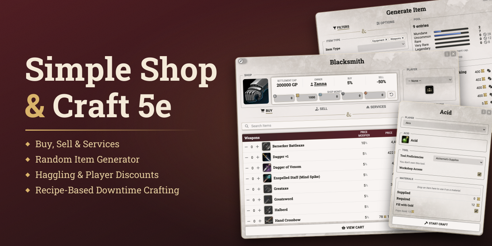

**Simple Shop & Craft 5e** adds shops and downtime crafting to the dnd5e system.

The GM sets up shops with their own stock, prices, and opening hours. Shops restock on their own as days
pass in the world calendar. Players buy and sell, haggle with the shopkeeper, and craft items from recipes
the GM provides.

Every purchase, sale, and craft order goes to the GM as a chat card and only takes effect once approved.

## Contents

- [Getting Started](#getting-started)
- [Shops](#shops)
- [Prices & Haggling](#prices--haggling)
- [Random Item Generator](#random-item-generator)
- [Crafting](#crafting)
- [Settings](#settings)
- [Credits & License](#credits--license)

---

## Getting Started

Open the **Shop & Craft** window with its button at the top of the Items sidebar. The GM builds shops and
recipes here, and players come here to browse the shops and recipes available to them.

A new shop needs only a name. Pick a Starter Pack to fill its shelves right away with the stock of a
Blacksmith, Alchemist, Tavern, General Store, Magic Shop, or Blackmarket. Starter Packs take their items
from the Player's Handbook, or the SRD without it. Every new shop starts out Inactive and stays hidden from
players until the GM opens it for business.

---

## Shops

### Shop Manager

The Shops tab lists every shop with its owner, opening hours, Settlement Cap, and status.

- **Active and Inactive.** Shops sit in separate groups, and players only ever see the Active ones. With
  Activation set to Scene Active in its Vendor Settings, a shop is Active only while one of its scenes is.
  Toggling it by hand lasts until the active scene changes.
- **Shop actions.** Right-click a shop to toggle it Active, open its Vendor Settings or Transaction Log,
  duplicate it, or delete it.
- **Show to All Players.** Opens the shop on every connected screen at once, for the moment the party steps
  through the door.

<table>
  <tr>
    <td colspan="2">
      <strong>Shop Manager</strong> 
      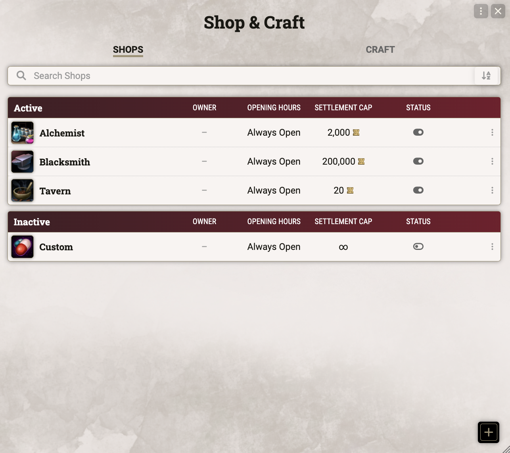
    </td>
  </tr>
</table>

### Shop Sheet

Each shop opens in its own sheet with four tabs. Its location and opening hours show under its name. The
header shows the shop's owner and its Buy and Sell modifiers. The GM also sees the Settlement Cap and the
shop money there, and finds buttons for the Vendor Settings and the Transaction Log in the title bar.

- **Buy.** The GM adds items from the Compendium Browser, by UUID, or by dragging them in. Fill from Table
  draws stock from a RollTable, configuring drawn Spell Scrolls and enchantment items by hand or at random,
  and Generate Item rolls up new wares (see
  [Random Item Generator](#random-item-generator)).
- **Sell.** Lists the items of the buying character that the shop accepts (see
  [Stock & Restock](#stock--restock)). Items bought as a bundle, such as arrows, are sold back one piece at
  a time. With Tidy 5e Sheets active, the items are grouped by the custom sections of the character's
  inventory instead of by item type.
- **Services.** Holds Lodging and Hirelings, along with any Buy item marked as a Service. A service costs
  coin but hands over no item.
- **Description.** A description of the place and the days the shop is closed. Outside its opening hours
  players can't enter the shop, unless the GM forces it open.
- **Who buys.** Players shop with their own character or with the Party actor.
- **Checkout.** Purchases and sales gather in a cart and go out as one order.
- **Stacking.** A bought item gains quantity on an item of the same type and identifier that the character
  already owns, instead of arriving as a copy. Containers and items with the default identifier, the item
  type such as "weapon", never stack. The GM sees a warning icon in the Buy tab for items that can't stack
  and for duplicate entries.

<table>
  <tr>
    <td width="60%">
      <strong>Buy tab</strong> 
      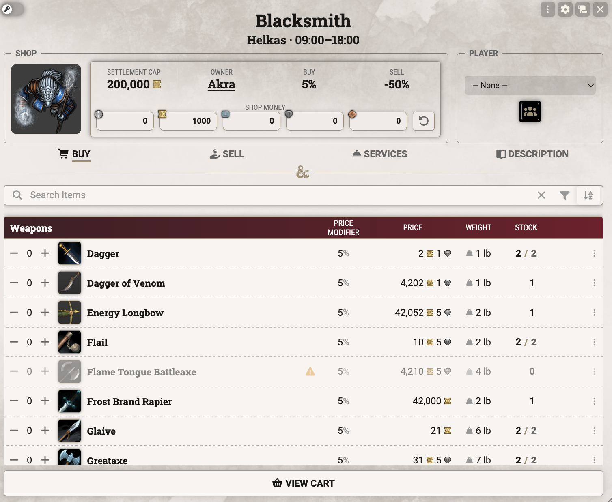
    </td>
    <td width="40%">
      <strong>Cart and GM confirmation</strong> 
      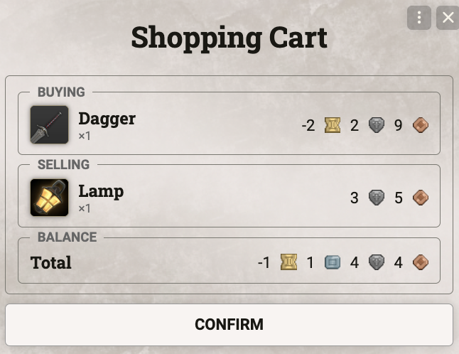 
      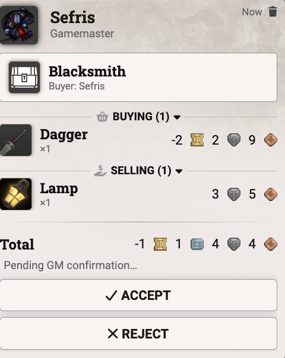
    </td>
  </tr>
</table>
<table>
  <tr>
    <td width="50%">
      <strong>Services tab</strong> 
      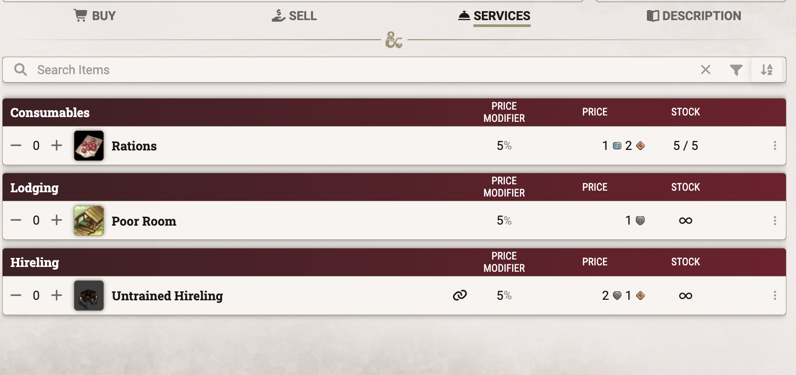
    </td>
    <td width="50%">
      <strong>Description tab</strong> 
      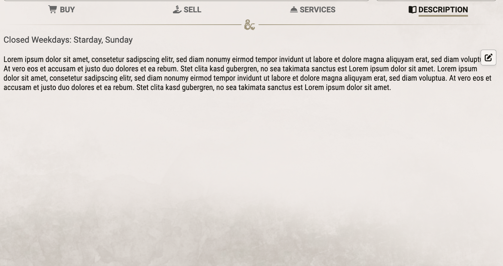
    </td>
  </tr>
</table>

### Stock & Restock

The Vendor Settings have three tabs. General holds the shop's name, owner, icon, location, scenes, and
opening hours. Prices holds its modifiers and Settlement Cap. Money & Stock holds its money, the item types
it buys, the default stock for new items, and the Restock Days. Each item has its own Item Settings, which
the GM opens with the pencil button in Edit mode or from the item's menu.

- **Stock modes.** Each item has Normal Stock, Unlimited Stock, or Exclude from Stock, set in its Item
  Settings. Excluded items keep their count but never restock, for the one-of-a-kind piece.
- **Current stock.** The GM changes the current stock of an item right in the Stock column, in any mode.
- **Default stock.** New items start with a max stock set per item type. The Magical Items rule decides
  which magic items skip that default and start excluded instead. Any item can still set its own Max Stock
  in its Item Settings.
- **Shop money.** The GM sees the shop's current money in the header and can edit it at any time. The
  Restock Amount in the Vendor Settings is what it returns to on restock, or the shop has Unlimited Money.
  Purchases by players can push the current money past that amount. With Purchase Only, the shop buys
  nothing from players.
- **Accepted Item Types.** Limits which item types, and optionally subtypes, the shop buys from players. The
  Sell tab then lists only matching items. Left empty, the shop buys anything. Not available with Purchase
  Only.
- **Restock.** Reset Stock & Shop Money refills every Normal item and returns the shop money to the Restock
  Amount. On the chosen Restock Days this happens on its own at the next in-game day change. This needs a
  calendar source (see [Settings](#settings)).

<table>
  <tr>
    <td width="50%">
      <strong>Vendor Settings: General</strong> 
      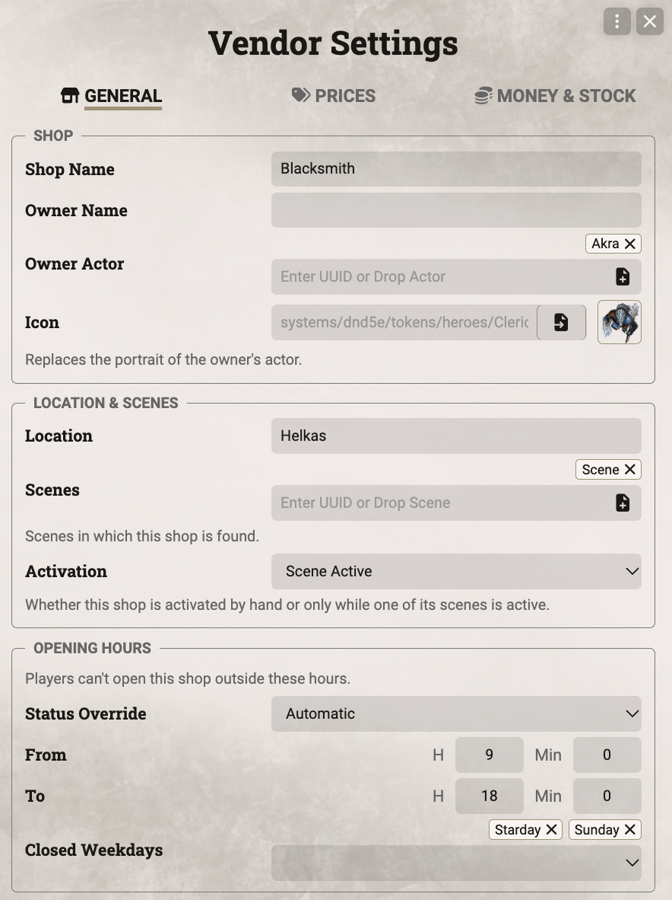
    </td>
    <td width="50%">
      <strong>Vendor Settings: Prices</strong> 
      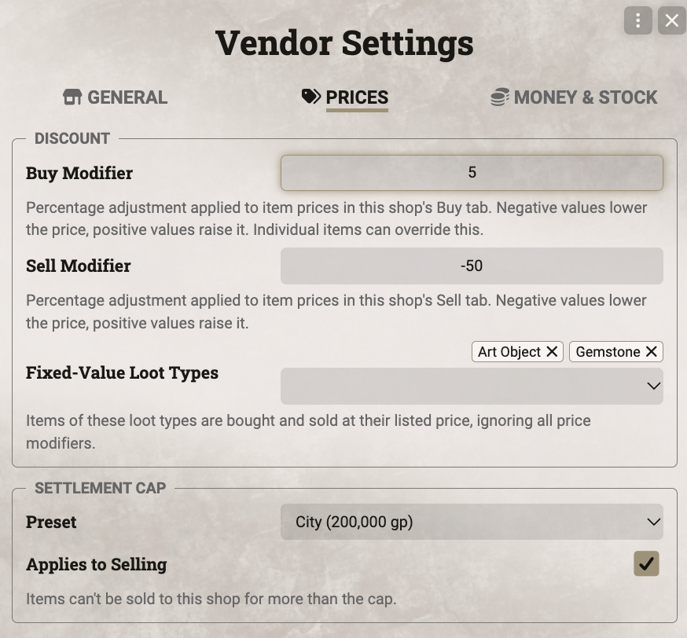
    </td>
  </tr>
  <tr>
    <td width="50%">
      <strong>Vendor Settings: Money & Stock</strong> 
      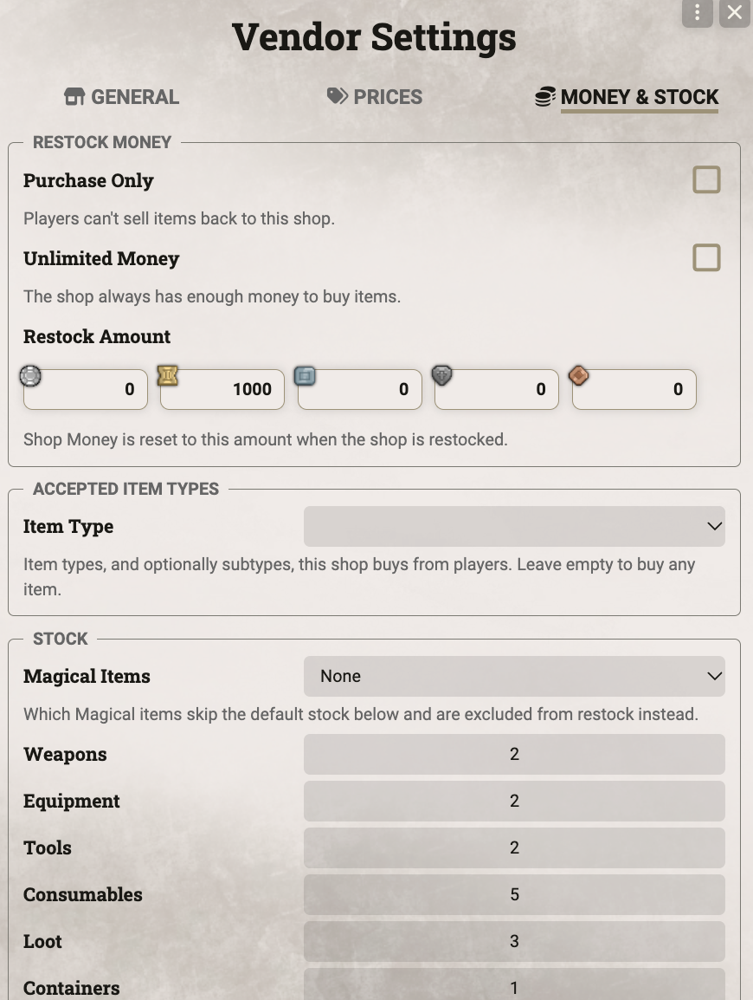
    </td>
    <td width="50%">
      <strong>Item Settings</strong> 
      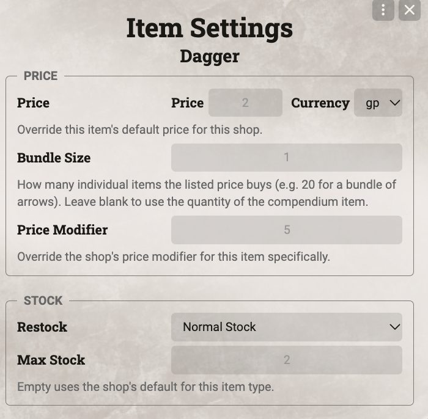
    </td>
  </tr>
</table>

### Transaction Log

Every purchase and sale the GM accepts is written to the log.

- **Opening.** Open a shop's log with the button in the title bar of its sheet or from its menu in the Shop
  Manager.
- **Entries.** Each line shows the time, the character, the items bought and sold, and the net amount, which
  is negative when the shop paid the character. The search field narrows the list.
- **Sharing.** Export a shop's log to JSON and import it into a shop's log, in this or another world.
  Entries the log already holds are skipped.
- **Clearing.** Clear Log deletes the entries shown in the window. Deleting a shop deletes its log too.
- **Limit.** Once the log is full, the oldest entries drop out. Logging is on by default, and it and the
  limit are set in the module settings.

<table>
  <tr>
    <td>
      <strong>Transaction Log</strong> 
      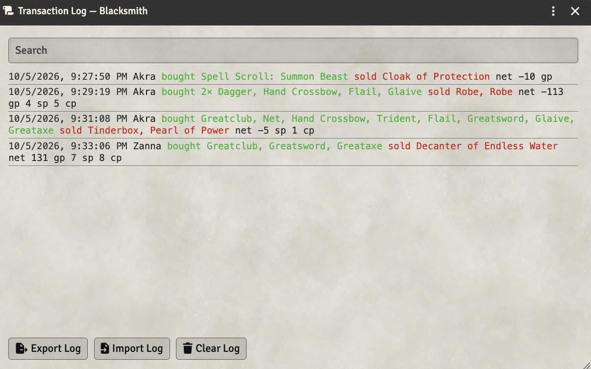
    </td>
  </tr>
</table>

---

## Prices & Haggling

### Price Modifiers

Every price starts from the item's own value and passes through the shop's modifiers. A tooltip on each price
shows which modifiers applied.

- **Shop modifiers.** A Buy and a Sell modifier apply to every trade, by default +0% and −50%.
- **Item overrides.** In its Item Settings, an item can have its own price, or its own modifier in place of
  the shop's.
- **Fixed-Value items.** Gemstones, art objects, and trade goods keep their full value, bought or sold. The
  list of loot types is set per shop.
- **Crafter.** With the 2024 rules, a character with the Crafter feat pays 20% less for nonmagical items,
  but not for services.
- **Passionate Trader.** A character with the Passionate Trader feat of the Ember module can mark items in
  the Sell tab to sell them at their full price.
- **Settlement Cap.** A village, town, or city only deals in items up to 20, 2,000, or 200,000 GP, or up to a
  custom cap. Pricier items stay hidden from players, and the cap can apply to selling as well.

<table>
  <tr>
    <td width="30%">
      <strong>Price modifier breakdown</strong> 
      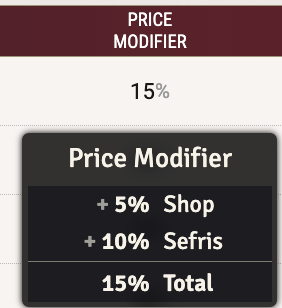
    </td>
  </tr>
</table>

### Player Discounts & Haggling

The GM can grant single players their own deal, and players can try to haggle the price down.

- **Player discounts.** Drop an actor into the Players dialog and give it its own Buy and Sell modifier. It
  adds to the shop's modifier.
- **Haggling.** The player picks Buy or Sell as the transaction, then rolls a Charisma skill against a DC
  equal to the shopkeeper's Intelligence score, minimum 15. A Friendly shopkeeper grants Advantage, a
  Hostile one Disadvantage.
- **Result.** On a success, a tray appears under the roll for the GM only. It offers a discount (Buy) or a
  bonus (Sell) of 5, 10, 15, 20, or 25 percent, with 10 preselected. Apply sets the player's modifier for
  that side at this shop and replaces the one it had, Reject leaves it alone. The modifier stays until the
  GM changes it in the Players dialog.
- **Cooldown.** A failed roll locks that skill on that side of the shop, a success locks every Charisma skill
  on that side. The lock lifts 24 hours of in-game time after the roll, or the GM resets it in the Players
  dialog.

<table>
  <tr>
    <td width="50%">
      <strong>Haggle dialog</strong> 
      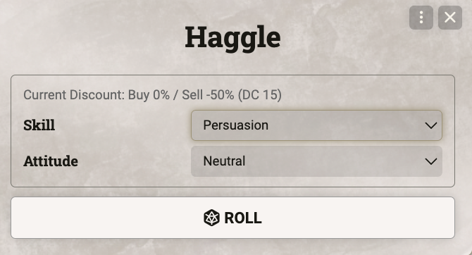
    </td>
    <td width="50%">
      <strong>Haggle result</strong> 
      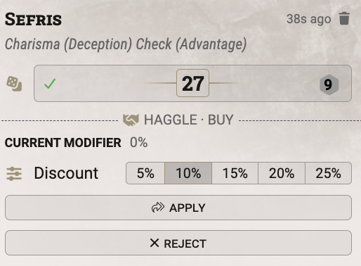
    </td>
  </tr>
</table>
<table>
  <tr>
    <td width="50%">
      <strong>Player discounts</strong> 
      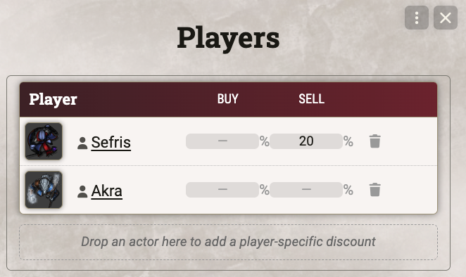
    </td>
  </tr>
</table>

---

## Random Item Generator

Generate Item rolls up new stock for a shop. The GM reviews every result before it goes on the shelf.

- **Filters.** Combine item types, each with its own subtypes and base items, and narrow the roll by rarity
  and magic.
- **Genuine magic items.** Enchantment templates become the real thing, so a "+1 Weapon" rolled for a Dagger
  arrives as a true +1 Dagger.
- **Additional Items.** The Additional Items of an enchantment, such as the Clawed Gauntlets of Demon Armor,
  are listed next to the item in the Buy tab and go to the buying character along with it.
- **Spell Scrolls.** Each scroll carries a real spell, filtered by school, class, level, or rituals.
- **Enspelled Items.** Enspelled Staffs, Weapons, and Armor come bound to a random spell of the level their
  rarity allows.
- **Weighting and pool.** Tune how often enchanted items come up, and see how many entries each rarity holds.
- **Results.** Up to ten items per roll. Reroll or remove single results, then add the rest to the shop.

<table>
  <tr>
    <td width="100%">
      <strong>Generate Item dialog</strong> 
      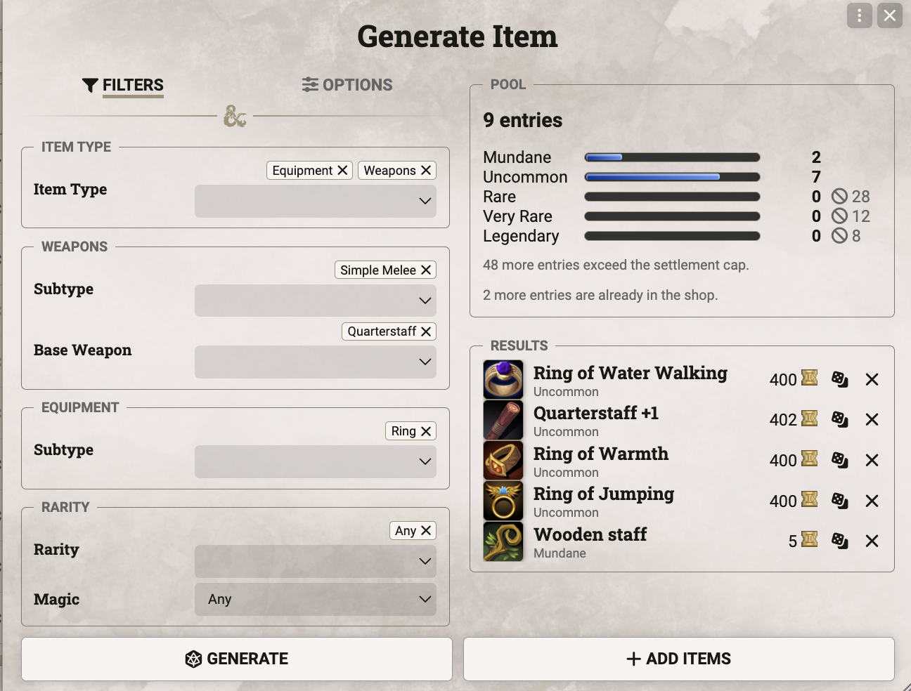
    </td>
  </tr>
</table>

---

## Crafting

### Recipes

The Craft tab lists every recipe with its material value, duration, and required proficiencies, grouped by
the type of item it makes. The group button above the list switches to grouping by tool proficiency, with
recipes that need no tool under No Tool. Click a recipe to start crafting it. The GM writes recipes in the
Recipe Editor, where clicking the name of a target item or material opens it.

- **Target item.** The item a recipe makes and how many per craft. Cost and duration follow the item's
  crafting value, or the GM sets a custom duration. A recipe can also skip the crafting value and rely on its
  materials alone.
- **Materials.** Each material is a fixed item or a rule, such as any gemstone worth 50 GP. The materials
  only need to reach the recipe's total value, unless the GM marks one as Required. With Freeform Materials,
  players may offer any item of enough value.
- **Recognition.** A character's items count as a fixed material by identifier and item type. An item with
  the default identifier doesn't count, unless the material uses Change Identifier to name the identifier
  to look for.
- **Proficiencies.** Tools and skills combine by Proficiency Mode: Tool & Skill, Tool or Skill, or Every
  Listed Tool & Skill. With Workshop Override, a character can work in a proper workshop instead of owning
  the tool. Choosing a target item suggests the tools that can craft it.
- **Unlock.** A recipe is open to listed actors only, to everyone, or to every character proficient with its
  tool.
- **Spell Scrolls.** With a Spell Scroll as its target, the crafter picks a spell of the recipe's level, from
  their prepared or known spells or from any compendium.
- **Enchantable items.** With an enchantment template as its target, such as a magic weapon or armor, the recipe
  is configured like an item added to a shop, with its profile and base item. The Additional Items of the
  enchantment come with the finished item.
- **Default recipes.** With the modern rules, Import Default Recipes creates a recipe for each item of the
  Player's Handbook, or the SRD 5.2 without it, that a chosen tool can craft, skipping items that already
  have one.
- **Missing items.** A recipe whose target item can't be found is greyed out with a warning for the GM and
  hidden from players.
- **Sharing.** Export recipes to JSON and import them into another world.

<table>
  <tr>
    <td width="40%">
      <strong>Recipe editor</strong> 
      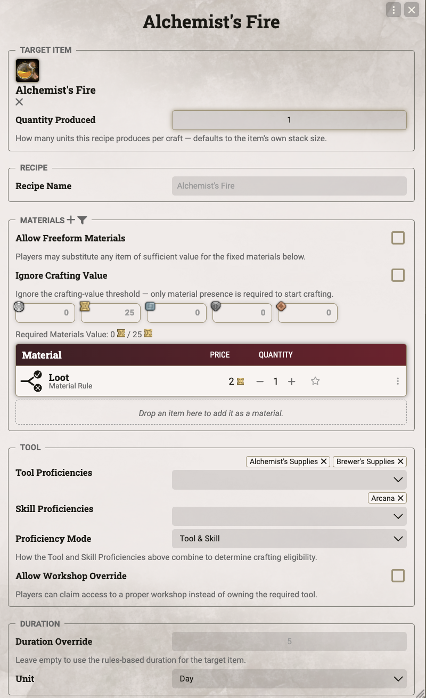
    </td>
    <td width="60%">
      <strong>Recipe list</strong> 
      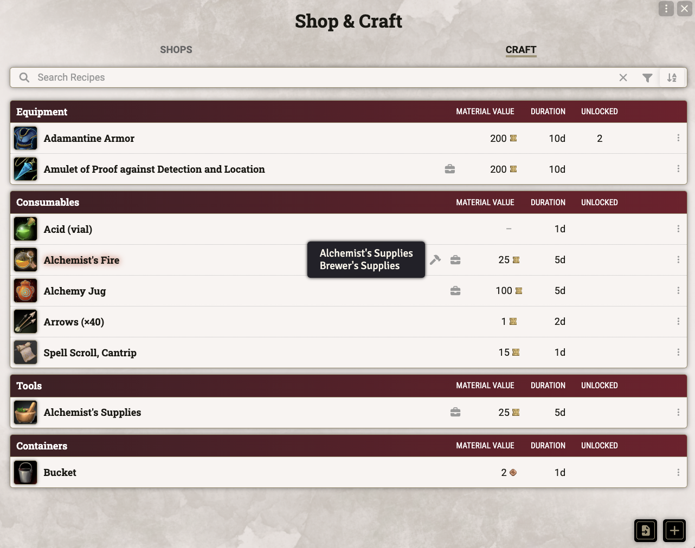
    </td>
  </tr>
</table>

### Crafting an Item

A player starts a craft from the Craft tab. Once the GM approves, the work goes on through the character's
downtime.

- **Start Craft.** Choose the character. The Requirements list every tool and skill the recipe asks for and
  what is still missing. Then add owned materials, and pay any value still missing in gold. For a Spell
  Scroll, pick the spell and set its save DC and attack bonus, which default to the crafter's own.
- **Quantity.** Craft the recipe several times in a row. Materials and cost multiply, and each run takes its
  own crafting time. Quantity isn't offered for containers.
- **Approval.** The order goes to the GM as a chat card. On acceptance, materials and gold are spent and an
  in-progress item appears in the character's inventory.
- **Working.** Use the Progress Craft activity of the in-progress item and enter the hours to work. A
  character works up to 8 hours a day by default, and the count resets on a Long Rest. Each session posts
  its progress to chat.
- **Assistants.** The Progress Craft dialog lets the crafter pick characters to assist. An assistant meets
  the recipe's proficiency requirements, with a workshop standing in for the tool if the recipe allows it,
  and has hours left in their own workday.
- **Calendar time.** With a calendar source active, a session runs as in-game time passes. It completes on its
  own once the planned hours are done, or the GM ends it early and credits the time spent. Assistants get
  back the hours not worked.
- **Completion.** When a run's work is done, the finished items go into the character's inventory and stack
  onto a matching item the character already owns. The in-progress item is removed after the last run.

<table>
  <tr>
    <td width="50%">
      <strong>Start Craft dialog</strong> 
      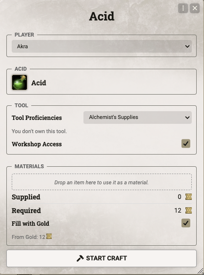
    </td>
    <td width="50%">
      <strong>Craft confirmation</strong> 
      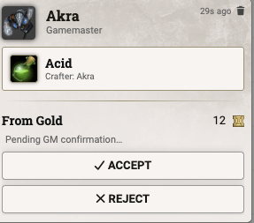
    </td>
  </tr>
  <tr>
    <td colspan="2">
      <strong>Crafting progress</strong> 
      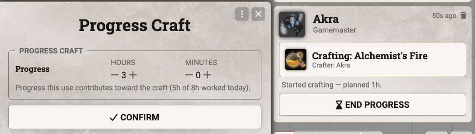
    </td>
  </tr>
</table>

---

## Settings

Three menus and two settings in the module settings hold world-wide options.

- **Configure Defaults.** The Buy and Sell modifiers, Restock Amount, Magical Items rule, and default stock
  per item type that every new shop starts with.
- **Configure Homebrew.** Max Hours per Workday for crafting, 8 by default, Crafting Assistants on or off,
  Maximum Assistants, and the Calendar Mode.
- **Calendar Mode.** Restock days, haggling cooldowns, and crafting sessions can follow Foundry's world
  calendar. Calendar Mode turns on by itself when a world clearly keeps its calendar in use: Calendaria or
  Ember is active, or dnd5e's Daily Recovery Mode is set to Calendar Recovery. Set it to Always On or Always
  Off to decide by hand.
- **Transaction Log.** Opens the log of all shops. Log Transactions turns logging on or off, and Maximum Log
  Entries sets how many transactions the log keeps, 1,000 by default.

---

## Credits & License

- **License.** Released under the [MIT License](LICENSE).
- **Font.** The banner uses [Roboto Slab](https://fonts.google.com/specimen/Roboto+Slab) under the Apache
  License 2.0.
